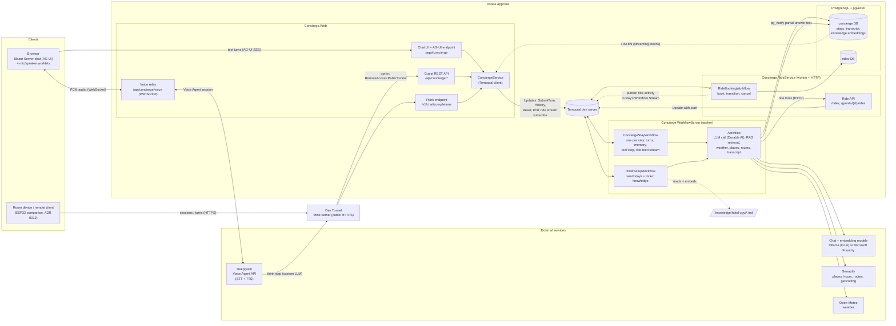

# Architecture overview

Top-level view of the Concierge Agent as orchestrated by the Aspire AppHost
([AppHost.cs](../src/Concierge.AppHost/AppHost.cs)). Every guest turn, from any client, becomes a
Temporal Update on one long-running `ConciergeStayWorkflow` per stay; that workflow is the single
source of truth for the conversation.

## How a turn flows

1. **Text.** The browser posts to the AG-UI endpoint. `StayWorkflowChatClient` forwards the latest
   user message through `ConciergeService` as a `SubmitTurn` Update on the stay workflow.
2. **Voice.** The browser streams audio to the Web voice relay, which owns the Deepgram Voice Agent
   session. Deepgram's think step calls back through the dev tunnel to the Think endpoint, which
   submits the same `SubmitTurn` Update. Deepgram speaks the answer back through the relay.
3. **Remote clients.** The room device calls `/api/concierge/sessions` and `/turns` over the tunnel
   (opt-in). Same Update, same stay.
4. **Inside the workflow.** The stay workflow retrieves hotel knowledge (pgvector), runs the model
   as a durable activity, and executes tool calls (weather, places, opening hours, routes, rides) as
   activities. It persists the transcript to Postgres.
5. **Streaming back.** The model activity publishes partial answer text with `pg_notify`; Web
   `LISTEN`s and streams it to the chat while the Update completes.
6. **Rides.** Ride tools call the ride service over HTTP. It runs a `RideBookingWorkflow` per ride
   and publishes status changes onto the stay workflow's Workflow Stream, which Web subscribes to
   for the ride activity panel.

## Startup

`HotelSetupWorkflow` seeds the demo stays and chunks and embeds `knowledge/hotel-zgy/*.md` into
pgvector. The workflow server's readiness check gates the Web start.

## See also

- [architecture.html](architecture.html): infographic version of this page
- [configuration.md](configuration.md): settings for every service
